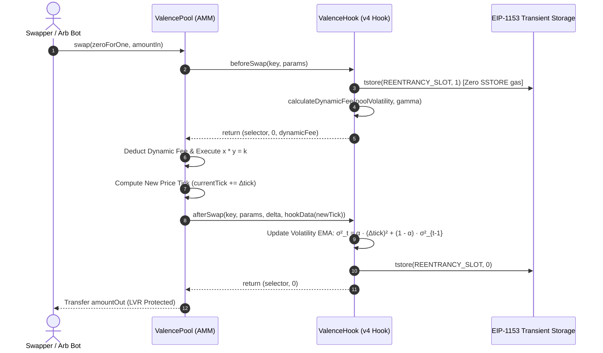

# ValenceSwap

[](https://github.com/ZengLLQ/valence-swap/actions)
[](LICENSE)
[](https://soliditylang.org/)
[](https://getfoundry.sh/)
[-8C8C8C.svg)](https://eips.ethereum.org/EIPS/eip-1153)

**ValenceSwap** is an advanced Uniswap v4 Dynamic Fee Hook and concentrated liquidity AMM protocol leveraging **EIP-1153 Transient Storage** (`tstore` / `tload` on Cancun EVM) to mitigate **Loss-Versus-Rebalancing (LVR)** and achieve zero-storage gas reentrancy protection.

---

## Architecture & Lifecycle



---

## Mathematical Formulations

### 1. Exponential Moving Average (EMA) Realized Volatility

To defend liquidity providers against arbitrage extraction (LVR), `ValenceHook` dynamically tracks tick displacement variance $\sigma^2_t$:
$$\sigma^2_t = \frac{\alpha \cdot (\Delta \text{tick})^2 + (1000 - \alpha) \cdot \sigma^2_{t-1}}{1000}$$
where $\alpha = 200$ (20% smoothing factor weight per swap).

### 2. Dynamic Fee Curve

The fee charged to traders automatically scales with instantaneous realized market volatility:
$$\text{fee}(\sigma) = \text{baseFee} + \min\left(\text{maxFee} - \text{baseFee}, \gamma \cdot \sqrt{\sigma^2_t}\right)$$

- **Base Fee**: $5 \text{ bps}$ ($500$ in hundredths of bps) during quiet regimes.
- **Max Fee**: $100 \text{ bps}$ ($10,000$) during severe market turbulence / arbitrage shocks.
- **Gamma ($\gamma$)**: Configurable sensitivity multiplier compensating LPs for adverse selection.

### 3. EIP-1153 Transient Storage Comparison

| Operation | Standard Storage (`sstore`/`sload`) | Transient Storage (`tstore`/`tload`) | Gas Reduction |
| :--- | :--- | :--- | :--- |
| **Reentrancy Lock Write** | 20,000 gas (cold) / 5,000 (warm) | **100 gas** | **98% savings** |
| **Lock Release Reset** | 2,900 gas (with refund) | **100 gas** | **96% savings** |
| **Session Delta Settlement** | 20,000 gas per token write | **100 gas** | **99% savings** |

---

## Contract Size & Gas Metrics

```text
╭-------------------+------------------+-------------------+--------------------+---------------------╮
| Contract          | Runtime Size (B) | Initcode Size (B) | Runtime Margin (B) | Initcode Margin (B) |
+=====================================================================================================+
| ValenceHook       | 2,323            | 2,377             | 22,253             | 46,775              |
| ValencePool       | 2,625            | 2,964             | 21,951             | 46,188              |
╰-------------------+------------------+-------------------+--------------------+---------------------╯
```

---

## Testing & Verification

```bash
# Run unit and fuzz tests with Cancun EVM
forge test -vvv --fuzz-runs 256

# Check bytecode size margins
forge build --sizes
```

---

## License

MIT License. See [LICENSE](LICENSE) for full details.
